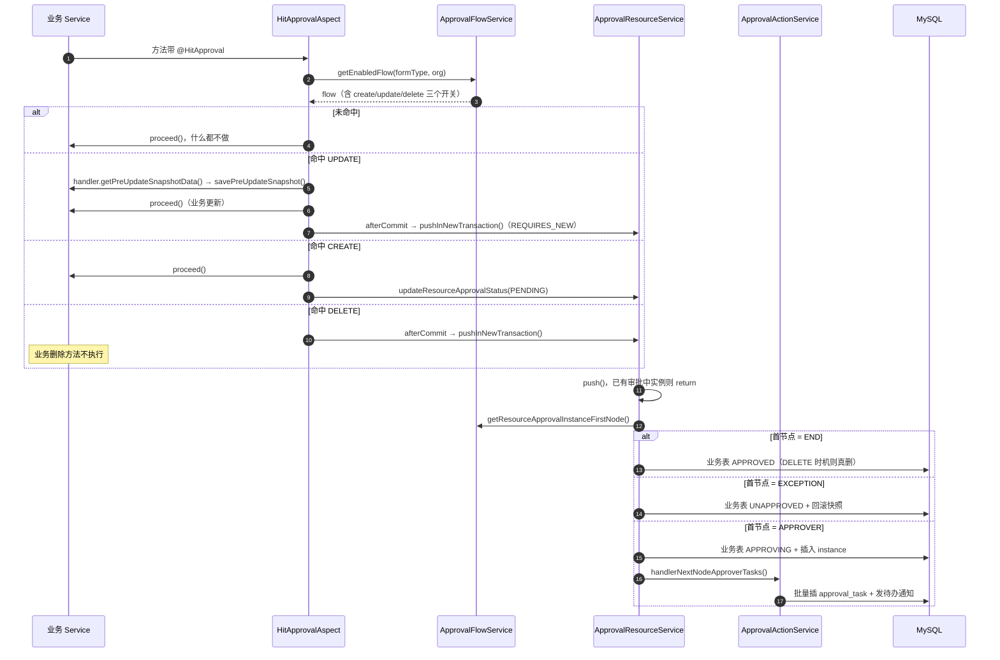
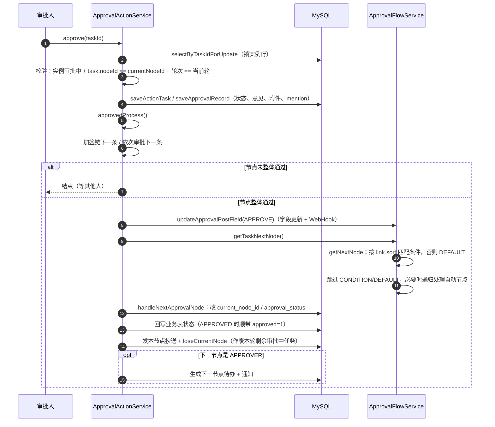

# CordysCRM 审批模块完整蓝图

> 一份文档覆盖审批的全部内容：**概念 → 运行时 → 功能（触发/权限/通知/展示）→ 0→1 接入 → 验收 → 排查 → 边界与成本**。
>
> 结论基于 `98e174742` 的代码阅读和 `purchase`（采购单）端到端实测。类名/方法名稳定，行号会漂。
> 通知渠道、模板、多端发送的细节见配套文档 [notification-module-design.md](./notification-module-design.md)。

怎么读这篇：

- 要把自家业务接进审批 → 第五部分，前面四部分当查询手册用
- 要改引擎，或者查"为什么流转不对" → 第三、四部分
- 只想找报错原因 → 第六部分

---

## 目录

| 部分 | 内容 |
| --- | --- |
| [一](#一引擎在管什么) | 引擎在管什么：两个字符串、三层职责 |
| [二](#二数据长什么样) | 数据长什么样：设计态 / 运行态 / 业务表契约 |
| [三](#三运行时怎么跑) | 运行时怎么跑：两条主链路、条件、审批人、状态、动作 |
| [四](#四触发权限通知与显示) | 触发、权限、通知、显示 |
| [五](#五从零接入一个新实体) | 从零接入一个新实体：决策 → 库 → 后端 → 自检 → 验收 → 前端 |
| [六](#六排查手册) | 排查手册：症状 → 原因、静默失效清单 |
| [七](#七边界与成本) | 边界、成本与未验证项 |

---

# 一、引擎在管什么

## 1.1 引擎只认两个字符串

```
formType    这张单子是什么类型（contract / order / purchase / customFormId）
resourceId  是哪一条业务数据
```

流程配置、状态机、加签退回撤回、抄送、评论、字段权限、状态权限，全部与业务无关，都建立在 `(formType, resourceId)` 之上。`resourceId` 只是字符串，引擎不需要认识你的表。

职责切三层：配置层管流程长什么样（节点顺序、条件分支、审批人算法），运行层管这一单走到哪了（实例、待办、轮次、留痕），适配层管怎么读写你的业务数据。三层之间只靠 `formType` 和 `resourceId` 两个字符串对齐，引擎不需要认识你的表。

一个业务对象想接入审批，本质上就是提供一个 `formType`，外加一套"怎么读我 / 怎么改我 / 怎么回滚我"的实现。

## 1.2 为什么接入步骤多但都不难

引擎**没有插件发现机制**。它不扫描"谁实现了审批接口"，而是用三种硬编码方式分派：

| 机制 | 例子 | 加新类型时的表现 |
| --- | --- | --- |
| 枚举 | `FormKey`、`ApprovalFormTypeEnum`、`FieldSourceType` | 不加：被当成"自定义表单"或 NPE，走错分支 |
| `static` Map | `FORM_APPROVAL_TABLE`、`FORM_SERVICE`、`approvalSources` | 不加：查不到 → null → 静默降级 |
| `switch` / 穷举数组 | 显示名、日志模块、通知事件、待办资源名、权限点 | 不加：走 `default` → 空字符串/空列表 |

注册点多是这个架构的固有代价，不是设计缺陷。你要做的只是登记：把你的类型登记进引擎的每一张表里。

真正需要写逻辑的只有三处：

1. `ApprovalResourceHandler` —— 引擎回调你（删数据、存快照、回滚、审批后置字段）
2. `ResourceAccessContextProvider` —— 告诉引擎"这条数据的负责人是谁"
3. 三个取数方法 `getSimple` / `batchGetSimpleByIds` / `getFieldValues` —— 条件求值与引用字段展示

其余全是登记。

---

# 二、数据长什么样

## 2.1 设计态

```
approval_flow（一条配置：form_type + create/update/delete_execute 三个开关 + 全局规则）
  └── approval_flow_version     ← 改节点配置就新建一个版本
        ├── approval_node       START / APPROVER / CONDITION / DEFAULT / END
        │     ├── approval_node_approver   审批人 + 多人方式 + 字段权限 + pass/reject 后置动作
        │     └── approval_node_condition  条件 JSON（CombineSearch）
        └── approval_node_link  from → to，带 sort（分支尝试顺序）
```

两个容易忽略的设计：

- **版本不可变**。实例创建时锁死 `flow_version_id`，之后管理员怎么改流程，在途单据都按提审那一刻的配置跑完。
- **节点带执行时机**（`approval_node.execute_time`：CREATE / UPDATE / DELETE）。同一流程可以给新建/编辑/删除配三套不同起点。

流程主表上的全局规则（用户感知上就是权限）：`submitter_can_revoke`、`allow_withdraw`、`allow_add_sign`、`allow_batch_process`、`require_comment`、`duplicate_approver_rule`、`status_permissions`。

## 2.2 运行态

```
approval_instance   一个业务数据在某个时机的一次审批（同一单据可有多次）
                   flow_version_id + type(=formType) + resource_id + resource_name(快照)
                   + execute_time + update_fields + submitter_id + current_node_id
  ├── approval_task            待办/已办最小单位：node_id + node_round + approver_id + status + type
  ├── approval_record          每一步留痕（结果 + 意见 + 附件）
  ├── approval_add_sign_task   加签链（sort 决定先后）
  ├── approval_return_back_record  退回记录（目标节点 + 原因）
  ├── approval_instance_attachment 意见附件
  └── approval_comment(+_mention)  审批页讨论区

approval_resource_snapshot   编辑前快照，驳回/撤回时回滚用（只有部分模块有）
```

任务类型：`NL` 普通审批、`CC` 抄送（只读，不影响流转）、`SN` 加签、`BK` 退回。

## 2.3 业务表契约：6 个列，2 个语义

审批模块自己只存"这条单据在走哪个流程"，不存单据内容。要显示单名、要通知人、要判断谁能看，它回头直接拼 SQL 读你的业务表（`ExtApprovalInstanceMapper.xml` 里的 `${sourceTable}`）。中间没有 ORM 兜底，列名写错或列缺失就是 SQL 报错，或者取到空值、功能静默失效。

| 列 | 审批模块拿它做什么 |
| --- | --- |
| `id` | 主键 |
| `name` | 待办、消息、日志里显示的单据名 |
| `owner` | 单据归属人：评论要通知他，数据权限按他算，负责人变更要认这个字段 |
| `organization_id` | 查负责人时限定组织，并核对资源属于哪个组织 |
| `approval_status` | 审批状态回写、状态权限过滤 |
| `approved` | **历史上是否审批通过过**；编辑时机降级判定依赖它 |

新表默认值：`approval_status = 'NONE'`、`approved = 0`。

### 三列分别在管什么

`name` 管显示。提审时读一次存进审批实例做快照，之后待办、已办、评论列表都读快照，不再查业务表。读不到的后果是列表里显示「资源不存在」；删除路径拼审批意见时没兜底，会直接抛异常。

`owner` 管归属。流程里所有"这条单据跟谁有关"的判断都落到它。别人在单据下评论，除了被 @ 的人，还要额外通知负责人；一个既不是提审人、不是审批人、也没被抄送的人想打开审批详情，系统用 `owner` 套他的数据范围（全部 / 本部门 / 只看自己）来决定能不能看；负责人被批量转移时，系统也要靠这个字段名认出"改的是负责人，该触发重新审批"。

`organization_id` 只做两件事：查负责人时限定组织，以及各业务模块读资源时核对它属于当前组织。对不上就当资源不存在。审批模块自己的实例、任务、评论隔离不用这一列，靠的是审批流版本表上的组织字段。

### 代码里对应的位置

| 列 | 读取位置 |
| --- | --- |
| `name` | `ApprovalResourceService.initInstance` 存快照；`ApprovalActionService` 拼日志和通知；删除路径 `HitApprovalAspect` |
| `owner` | `ApprovalCommentNoticeService.sendNotice`；`hasViewPermission`（详情）和 `hasInstanceViewPermission`（历史实例）→ `ResourceAccessContextProvider` → `DataScopeService`；`batchTransferTriggerApproval` |
| `organization_id` | `ExtApprovalInstanceMapper.getResourceOwner` 的 where；各 `ResourceAccessContextProvider.getAccessContext` / `batchGetOwnerIds` |

四条容易踩的前提：

- 评论通知只在**新增**评论时找负责人（`notifyOwner=true`），编辑评论只通知本次新增的被 @ 人。通知模板没开（`sys_message_task` 里没有 `APPROVAL` + `APPROVAL_COMMENT_MENTIONED`）就整段不执行。
- 报价单的表没有 `owner` 列，跳过是写死的 `formKey != FormKey.QUOTATION`，不看 `requiresOwner()`。新实体如果也没这列，评论通知那条 SQL 会报错，然后被 try/catch 吞掉，表现为通知静默不发。省事的做法是新表六列建齐。
- 查看权限两个入口结论相反：`/detail`、`/simple-detail` 走 `hasViewPermission`，`owner` 为空放行；`/instance-detail`（历史实例）走 `hasInstanceViewPermission`，`owner` 为空且 `requiresOwner()` 为真时不可见。
- 组织共享资源（如产品）用 `ResourceAccessContextProvider.requiresOwner()` 返回 false 关掉按负责人校验。

补列和写列名时还有三个坑：

- **存量表补列必须回填**：`UPDATE t SET approved = 1 WHERE approval_status = 'APPROVED'`。不回填的老数据，编辑一下就会要求重新审批。
- 状态回写不检查影响行数（`updateApprovalStatus` 返回 void），`id` 对不上就静默 0 行；表名或列名写错是 SQL 报错。
- 表名映射在 `ApprovalResourceService.FORM_APPROVAL_TABLE`（`static` HashMap，没有配置入口）。

## 2.4 常用术语

| 词 | 含义 | 为什么重要 |
| --- | --- | --- |
| `instance` | 一条数据在某时机的一次审批 | 同一单据有多条实例，只有一条"最新" |
| `task` | 待办/已办最小单位 | 一个节点 × 一个审批人 × 一轮 = 一条 task |
| `record` | 每步留痕 | 自动跳过也写 record，所以记录里有系统意见 |
| `node_round` | 节点第几轮被走 | 退回/二次提审/加签都会多轮；**按 nodeId 查任务必须带轮次** |
| `execute_time` | CREATE / UPDATE / DELETE | 决定找哪个 START，也决定驳回时要不要回滚 |
| `update_fields` | 本次编辑改了哪些字段 | 只服务 `NOT_EQUAL_ORIGINAL` 条件；来自 `@OperationLog` 的 diff |

---

# 三、运行时怎么跑

## 3.1 时序 A：业务写操作 → 有人收到待办



落点：`HitApprovalAspect#handleHitApproval` → `ApprovalResourceService#push` / `#pushInNewTransaction` / `#initInstance` → `ApprovalFlowService#getResourceApprovalInstanceFirstNode` → `ApprovalActionService#handlerNextNodeApproverTasks` / `#getNodeApproverTasks`。

## 3.2 时序 B：一次同意 → 流转 → 结束



## 3.3 拆开看

### ① 命中

`HitApprovalAspect` 做五件事：SpEL 解析参数 → UPDATE 降级判定 → 查启用流程 + 时机开关 → UPDATE 且命中则存编辑前快照 → `proceed()` 后按时机处理。

- 注解的 `formKey` **默认值是 `FormKey.ORDER`**，写漏不报错，静默按订单走。
- 自定义表单用 `formKeyExpr` 传 `customFormId`；`FormKey.ofKey(formType) == null` 是**合法状态**（= 自定义表单）。
- `updateType == approval`（审批内部回写）直接放行，避免二次提审。
- 切面 `@Order` 是 `HIGHEST_PRECEDENCE + 5`，必须排在 `@OperationLog` 之后 —— `update_fields` 从操作日志上下文算出来。

### ② 提审

`push` 的防重条件是"已有审批中实例"（`existsApprovingInstance`），所以重复点提交不会出两份待办。

`initInstance` 一次性固化：`flow_version_id`、`type`、`resource_name`、`execute_time`、`update_fields`、`submitter_id`。

首节点 = `node_type = START` 且 `execute_time = instance.execute_time` 的那一个。

### ③ 落任务

审批人解析 + 四层闸门（见 3.5）。这层是唯一会"凭空让节点通过"的地方。

### ④ 同意：锁 + 幂等

```java
task.getNodeId() == instance.getCurrentNodeId()            // 不是当前节点 → 流转走了
task.getNodeRound() >= 0                                   // < 0 是假删标记
task.getNodeRound() == getNodeRound(instanceId, nodeId)    // 不是最新轮 → 退回前的旧待办
```

`selectByTaskIdForUpdate` 先锁 `approval_instance` 行再动任务；批量审批按 `(instanceId, taskId)` 固定顺序取锁防死锁。

**对比：`reject` 没有锁、没有轮次校验、也没有 `@Transactional`**，重复点驳回可能重复写记录、重复回滚快照。

### ⑤ 判节点是否整体通过

| 多人方式 | 通过条件 |
| --- | --- |
| `ANY` 或签 | 本轮存在一个 `APPROVED` / `AUTO_APPROVED` |
| `ALL` 会签 | 本轮不存在 `APPROVING` |
| `SEQUENTIAL` 依次 | 本轮不存在 `APPROVING`；同意时顺手生成下一条/下 N 条自动通过任务 |

单人节点不套用或签规则，否则"前加签通过后原审批人任务还在审批中"会被误判通过。

### ⑥ 找下一个真正会落地的节点

```
取 link 里 from = 当前节点 的下一批
  ├ 没有条件节点 → 直接取第一个
  └ 有条件节点   → 按 sort 依次匹配 CONDITION；都不命中走 DEFAULT
```

`getNextNodeWithExceptionHandler` 把这批结果消化到底：CONDITION / DEFAULT 不落地继续跳；`AUTO_PASS` / `AUTO_REJECT` 节点写 record 并递归；审批人为空按配置自动过或换兜底人；人工节点才返回。条件分支不打断连续审批，进入分支前的审批节点保留。

### ⑦ 结束

```
instance.approval_status = APPROVED, approval_time = now
业务表 approval_status = APPROVED, approved = 1
DELETE 时机 → executeDeleteAction()（ThreadLocal 跳过审批切面）
发完结通知
```

节点通过后的固定顺序（写错就会出现"字段被回滚覆盖""抄送状态是旧的"）：

```
审核后置动作 → 流转到下一节点 → 发本节点抄送 → 作废本轮剩余审批中任务
```

驳回是反的：**先回滚快照，再执行驳回后置动作**。

## 3.4 条件怎么算

条件的值来自 `ModuleFormService.compressResourceDetail(formType, resourceId)`，它把业务详情 DTO 压成 `List<BaseModuleFieldValue>`，**DTO 属性名就是 fieldId**。所以条件里写 `amount`，DTO 就必须有 `amount` 属性；`sys_module_form` 没有字段配置时条件永远判空。

算子定义在 `ApprovalFlowService#matchFieldValue`：

| 算子 | 语义 |
| --- | --- |
| `EQUALS` / `NOT_EQUALS` | 列表对列表比 `equals`，其余 `Objects.equals` |
| `CONTAINS` / `NOT_CONTAINS` | 字符串包含 |
| `IN` / `NOT_IN` | 期望值是列表；实际值也是列表时取交集非空 |
| `GT` / `LT` / `GE` / `LE` | 能转数字按数字比，否则字符串比 |
| `BETWEEN` | 期望值 `[min, max]`，闭区间 |
| `EMPTY` / `NOT_EMPTY` | 判空 |
| `NOT_EQUAL_ORIGINAL` | 只判该字段是否在 `instance.update_fields` 里，不看值 |

子表条件的 fieldId 写成 `子表fieldId.子字段id`，取父字段的 List 逐行比对，任一行命中即成立。

AND / OR 由 `CombineSearch.searchMode` 决定，逐条件短路。

## 3.5 审批人怎么算

`resolveApprovers` 按 `approver_type` 分派：

| 类型 | 含义 |
| --- | --- |
| `MEMBER` | 指定成员（列表直接给 ID） |
| `ROLE` | 指定角色 → 展开成角色下所有用户 |
| `SUPERIOR` / `MULTIPLE_SUPERIOR` | 直属上级 / 往上第 N 级（`approver_direction` + `level`） |
| `DEPT_HEAD` / `MULTIPLE_DEPT_HEAD` | 部门负责人 / 往上第 N 级部门负责人 |

然后 `handleNextApproverNodeWithExceptionHandler` 依次过四层闸门，**每层都可能让整个节点直接通过**：

```
1. 节点审批类型      AUTO_PASS / AUTO_REJECT → 不产生人工待办
2. 审批人为空        自动通过 / 兜底审批人（fallback_approver）
3. 审批人 = 提交人   ALLOW / SKIP / ASSIGN_SUPERIOR
                     （转交上级；没有上级时，单人、或签可整节点跳过，会签/依次仍逐人处理）
4. 审批人重复出现    FIRST_ONLY / SEQUENTIAL_ALL / EACH → 结果写进 autoSkipUserIds
```

被跳过的任务不会凭空消失，它会生成一条 `AUTO_APPROVED` 任务，配一条系统意见的 record（"审批人重复出现，后续节点自动通过"），刻意留痕。

一层待办如果**全部**自动通过，`handlerNextNodeApproverTasks` 会立刻递归 `approvedProcess`，不会让实例卡在"审批中却没人有任务"。

## 3.6 状态迁移

| 状态载体 | 取值 | 谁写 |
| --- | --- | --- |
| 业务表 `approval_status` | `NONE → PENDING → APPROVING → APPROVED / UNAPPROVED / REVOKED` | 引擎（原生 SQL），业务代码不维护 |
| 业务表 `approved` | 0 / 1，是否曾经通过过 | 引擎；仅 `APPROVED` 时置 1 |
| `approval_instance.approval_status` | `APPROVING / APPROVED / UNAPPROVED / REVOKED` | 引擎 |
| `approval_task.status` | `APPROVING / APPROVED / AUTO_APPROVED / UNAPPROVED / AUTO_UNAPPROVED / REVOKED` | 引擎 |

| 事件 | 业务表 | 实例 |
| --- | --- | --- |
| CREATE 命中流程 | `PENDING` | 无 |
| 提交审批 / UPDATE 自动提审 | `APPROVING` | 新建 `APPROVING` |
| 首节点即 END | `APPROVED`（+`approved=1`） | `APPROVED` |
| 首节点即 EXCEPTION | `UNAPPROVED` | `UNAPPROVED` |
| 全链路走完 | `APPROVED`（+`approved=1`） | `APPROVED` |
| 任一节点驳回 | `UNAPPROVED` | `UNAPPROVED` |
| 提交人撤销 | `REVOKED` | `REVOKED` |
| 节点退回 | 不变 | 不变（`current_node_id` 回退） |

轮次由 `getNextNodeRound` 算出：`max(task.node_round, record.node_round, 0) + 1`。

任务从不清物理删除，分两种粒度：

| 方法 | 效果 | 用在 |
| --- | --- | --- |
| `loseCurrentNode` | 本轮剩余 `APPROVING` 任务 `status = 'NONE'`（保留轮次） | 节点流转通过后作废其他人待办 |
| `clearExpiredNode` | 该节点所有轮次的任务与 record `node_round = -1`，审批中任务同时 `status = 'NONE'` | 退回 / 撤回后清掉要重走的节点 |

加签时 `instance.current_node_id` 可能写成 `nodeId-SN`（常量名是拼错的 `SIGN_SPILT`），拿它查配置前必须 `split` 掉后缀。

## 3.7 审批动作

| 动作 | 入口 | 要点 |
| --- | --- | --- |
| 同意 | `approve` | 锁实例 → 校验节点/轮次 → 判节点通过 → 流转 |
| 驳回 | `reject` | 任一审批人驳回即整单驳回；先回滚快照再跑驳回后置动作；无锁（见 3.3④） |
| 加签 | `sign` | 需 `allow_add_sign`；`SN` 任务在节点内串行成链；前加签让原任务转回待审，后加签原任务直接 `APPROVED`；后加签 + 或签会立刻推进节点 |
| 退回 | `back` | 实例状态不变，`current_node_id` 指回目标节点；目标节点按新轮次重建待办（`appendBackTasks`），中间已执行节点清空（`clearBackToCurrentNode`）；自动通过/驳回节点不可退回 |
| 撤回（审批人） | `revoke` | 需 `allow_withdraw`，只能撤自己的任务；校验后续节点是否仍在审批中（会签/或签/依次三套规则不同）；成功后清掉后续节点待办等重走 |
| 撤销（提交人） | `ApprovalResourceService#revoke` | 需 `submitter_can_revoke`；业务表 `REVOKED` + 实例 `REVOKED` + 回滚快照 + `loseCurrentNode` |

批量同意/驳回只是循环单条逻辑，额外做的是**固定加锁顺序**。

## 3.8 收尾与清理

| 场景 | 行为 | 位置 |
| --- | --- | --- |
| 流程结束 | 发完结通知（按 FormKey 选模块/事件/模板）；DELETE 时机真删；之后异步发 WebHook | `ApprovalActionService#sendFinishNotice`、`ApprovalResourceService#executeDeleteAction` / `#sendWebHook` |
| 流程被删除 | 先清掉该流程所有版本下"审批中"的实例 | `ApprovalInstanceService#clearApprovingInstanceOfFlow` |
| 审批人被停用 | 把在途任务转给上级，没有上级转 admin | `ApprovalActionService#refreshApprovingTasksForDisabledUser` |
| 驳回/撤回 | 回滚快照并删除快照行 | `ApprovalActionService#revertFromSnapshot` |

---

# 四、触发、权限、通知与显示

## 4.1 触发入口

| 入口 | 位置 | 时机 | 行为 |
| --- | --- | --- | --- |
| 单条新建/编辑/删除 | `@HitApproval` 切面 | CREATE / UPDATE / DELETE | 见 3.1 |
| 手动提审 | `POST /approval-resource/push` | CREATE | 把 `PENDING` 推进流程 |
| 批量编辑字段 | `batchEditTriggerApproval` | UPDATE | 列表内联改一个字段，逐条判定后提审/置待提审 |
| 批量转移负责人 | `batchTransferTriggerApproval` | UPDATE | 同上，但 `updateFields` 写业务字段 key（`owner`） |
| 批量删除 | `batchDeleteTriggerApproval` | DELETE | 命中审批的不删，返回 ID 列表给调用方跳过 |
| 自定义表单批量版 | `batchEditTriggerApprovalForCustomForm` / `batchDeleteTriggerApprovalForCustomForm` | UPDATE / DELETE | formType 是 `customFormId` |
| 审批内部回写 | `updateType = approval` | — | 直接放行，不再触发 |

批量入口最终都落到 `triggerUpdateApproval`：

```
approved = 1 → handler.getPreUpdateSnapshotData() 存快照 → push(UPDATE, updateFields=[变更字段])
approved = 0 → 业务表置 PENDING，等手动提审
```

实现时有几点容易写错：

- `updateFields` 写什么因入口而异：普通批量编辑传**表单字段 id**，批量转移传**业务字段 key**（`owner`）。节点条件保存的是业务字段 key，传错就匹配不到条件分支。
- 批量删除是"建实例 + 返回命中审批的 ID"，调用方只删剩下的。
- 快照必须在业务数据变更之前取，否则驳回回滚回去的是变更后的值。

事务时序上两者不同：注解 UPDATE/DELETE 走 `afterCommit` + `REQUIRES_NEW`；批量入口在调用方事务内直接 `push`，所以条件读到的是变更前的值（批量编辑触发的流程可能按旧值分支）。

以下几种情况不会触发，而且都不报错：没有启用中的流程 / 时机开关关着 / 组织 ID 为空 / `updateType=approval` / 已有审批中实例 / 被状态权限过滤掉。

## 4.2 权限

| 权限 | 配在哪 | 谁消费 | 管什么 |
| --- | --- | --- | --- |
| 角色功能权限 | `permission.json` + `PermissionConstants` + 角色授权 | `@CsPermission`、`PermissionUtils.hasPermission` | 能不能进模块、调接口 |
| 状态权限 | `approval_flow.status_permissions`（矩阵） | `filterResourcesWithPermission`、前端 `useApprovalOperation` | 某状态下能不能编辑/删除/导出/转移 |
| 字段权限 | `approval_node_approver.field_permissions` | `currentNodeFieldPermissions` → `ApprovalFieldEditor` | 审批页哪些字段隐藏/只读/可编辑 |
| 数据权限 | 不配置，走角色数据范围 | `ResourceAccessContextProvider` + `DataScopeService` | 能看见哪些记录 |

四套是**串行叠加**的：角色权限决定能不能操作 → 状态权限决定这条记录当前状态能不能操作 → 数据权限决定能不能看见 → 字段权限决定审批页能改哪几格。

### 状态权限

存储形态是一张矩阵，每格 `(审批状态, 权限点, 是否启用)`：

```json
[{"approvalStatus":"APPROVING","permission":"CLUE_MANAGEMENT:UPDATE","enabled":false}, ...]
```

判定（`ApprovalFlowService#filterResourcesWithPermission`）：

```
状态为空或 NONE     → 不受限，放行
没配置状态权限       → 全部放行
所有资源都是 NONE    → 整批跳过校验（快路径）
状态有配置但没开      → 需要该权限点对应的角色权限
```

有两条硬规则：

- **审批中永远禁止编辑和删除**：`parseStatusPermissions` 读取时把 `APPROVING` 下的 `*:UPDATE` / `*:DELETE` 强制改回 `enabled = false`，配置界面改不动。
- **导出走独立分支**：`filterResourcesWithExportPermission` 只认带 `EXPORT` 后缀的权限点。

权限点必须来自 `getPermissionsByFormType(formType)` 列出的那批（即 `ApprovalFormTypeEnum.permissionId` 指向的权限树节点下的权限，排除 `IMPORT`）。formType 没进 `ApprovalFormTypeEnum` 时 `Objects.requireNonNull` 直接 NPE。

前端 `hooks/useApprovalOperation.ts` 按 `(状态 → 权限点集合)` 算按钮显隐，再和角色权限取交集（自定义表单数据可用 `ignoreRolePermissionCheck` 退化成只看状态）。**前后端各判一次**，绕过前端也过不了后端。默认矩阵模板在 `config/process-default-status-permissions.ts`。

### 字段权限

- 配在**审批人节点**上，不是流程上：同一流程不同节点可以给不同字段不同可编辑性。
- 三态 `HIDDEN` / `VIEW` / `EDIT`，只下发**当前节点**的配置。
- **加签节点强制降级为全 `VIEW`**（当前节点 ID 带 `-SN` 后缀时）。
- 存的是字符串 `"null"` 而不是 SQL NULL，代码靠 `NULL_FIELD_PERMISSION_STR` 判断。

### 数据 / 查看权限

两个入口，方法不同，空 `owner` 的结论也相反：

```
/detail、/simple-detail → hasViewPermission
  1. 参与人放行：提审人 / 任一节点审批人 / 抄送人
  2. 该模块 READ 权限点
  3. 数据权限：provider.getAccessContext → hasDataPermission(ownerId)
     owner 为空直接放行

/instance-detail（历史实例）→ hasInstanceViewPermission
  1. 组织匹配（实例版本组织 == 当前组织）
  2. 参与人放行
  3. 该模块 READ 权限点
  4. provider.requiresOwner() 为真且 owner 为空 → 不可见
  5. 数据权限：hasDataPermission(ownerId)
```

自定义表单在 `hasInstanceViewPermission` 里走 `CustomFormDataService#hasViewPermission`。`hasViewPermission` 拿不到实例类型时（资源没有审批实例），遍历所有 provider 反查归属。

`ResourceAccessContextProvider` 要实现的四个方法（`batchGetOwnerIds` 是抽象方法，少写编译不过）：

```java
String getFormType();                                        // 我管哪个 formType
ResourceAccessContext getAccessContext(id, orgId);           // 这条数据的 owner + approvalStatus
Map<String, String> batchGetOwnerIds(ids, orgId);            // 批量取负责人
default boolean requiresOwner() { return true; }             // owner 为空是否直接拒绝
```

产品重写 `requiresOwner()` 返回 `false`；报价单没有 `owner` 列，provider 拿 `createUser` 当 ownerId（与报价列表的 SELF / 部门数据范围一致），没重写 `requiresOwner()`。

### 流程级动作开关

不在权限体系里，是流程配置，但用户感知上就是权限：`submitter_can_revoke`（提交人撤销）、`allow_withdraw`（审批人撤回）、`allow_add_sign`（加签）、`allow_batch_process`（批量同意）、`require_comment`（必填意见）。

## 4.3 通知

| 场景 | module / event | 收件人 | 代码 |
| --- | --- | --- | --- |
| 有新待办 | `APPROVAL` / `APPROVAL_TODO` | 本轮所有 `APPROVING` 任务的审批人 | `ApprovalActionService#sendApprovalTaskNotice` |
| 抄送 | `APPROVAL` / `APPROVAL_CC` | 节点配置的抄送人 | `#sendCcNotice` |
| 审批完结 | 按 formType 分派的模块 / `*_APPROVAL` | 提审人（排除操作人自己） | `#sendFinishNotice` |
| 评论 / @ | `APPROVAL` / `APPROVAL_COMMENT_MENTIONED` | 被 @ 的人 + 业务负责人（报价单除外） | `ApprovalCommentNoticeService` |

完结通知的 module/event 是**按 formType 硬分派**（`switch`）：未枚举的 formType 落到默认"审批"模块，`switch` 漏写 `case` 就静默不发。

管道：

```
引擎/业务
  → CommonNoticeSendService.sendNotice(module, event, params, operatorId, orgId, receivers, excludeSelf)
      → @Async 线程池
      → NoticeSendService.send(module, model)
          → 查 sys_message_task：这个 (module, event) 配了哪些渠道（站内信/邮件/企微/钉钉/飞书）
          → 没有配置行 = 静默不发
          → 按模板渲染（i18n key + params）
```

模板变量固定键：`name`（单据名）、`type`（单据类型名）、`state`（状态文案）、`useTemplate` / `templateKey` / `resourceType` / `resourceId`（评论专用）。

接入要配的东西：

```
NotificationConstants.Module.<XX>                         模块（= sys_message_task.task_type）
NotificationConstants.Event.<XX>_APPROVAL                 事件
NotificationConstants.TemplateText.<XX>_APPROVAL_TEXT     模板字段
sys_message_task 插一行 (event, task_type, sys_enable=1)   ← 唯一的数据配置
i18n 中英文案
```

最后那行最容易漏：发送方按 `(module, event)` 查配置，查不到既不报错也不发。

## 4.4 展示

| 读模型 | 接口 | 内容 | 用在哪 |
| --- | --- | --- | --- |
| 列表行审批信息 | 业务列表接口自带 | `approval_status`、首节点是否已通过、提审人 | 状态标签、按钮显隐 |
| 资源审批简详情 | `GET /approval-resource/simple-detail/{resourceId}` | 审批状态 + 字段值 + 操作按钮 | 业务详情页顶部审批条 |
| 实例详情（审批链） | `GET /approval-resource/detail/{resourceId}` | `ApprovalInstanceDetail`：节点树 + 记录 + 附件 + 字段权限 | 审批记录、审批抽屉 |
| 历史实例 | `GET /approval-resource/instance-detail/{resourceId}` | 同一单据的多次实例 | 审批历史 |
| 待办五视图 | `/approval-todo/{pending,processed,initiated,cc,mention}/page` | 统一 `ApprovalTodoItemResponse` | 待办抽屉五个 tab |

### 审批链是怎么拼出来的

`ApprovalInstanceService#buildApprovalRecordNodeList` 把五份数据合并成一棵可渲染的节点树：

```
processed  已执行：task + record 按 (node_id, node_round) 合并，
           带加签链（SN）、退回记录（back_reason + 附件）、意见附件
pending    未来节点：按流程配置向后推演
end        结束节点：已通过 / 已驳回
cc         每个节点的抄送人折叠成 ccNodes
---------- 合并规则 ----------
· 历史实例只展示实际执行过的节点
· 同一节点既在 processed 又在 pending → 以 pending 为准（避免旧轮次残留重复显示）
· 加签节点用 nodeId-SN 区分
```

节点带 `approvalStatus`、`multiApproverMode`、`endNode`、`backNode`、`backReason`，前端只渲染不推断。

### 名称从哪来

| 路径 | 数据源 | 用在哪 |
| --- | --- | --- |
| 实例快照 | `approval_instance.resource_name`（提审时写入） | 通知、评论提醒 |
| 实时批量查 | `ApprovalTodoService#loadResourceNameMap` 按 formType `switch` 查业务表 | 待办五视图 |

这两条路是分开的，所以"待办列表名字空"和"通知里名字空"是两个独立漏项。

### 前端组件

| 组件 | 职责 |
| --- | --- |
| `crm-approval/components/crm-approval-detail.vue` | 审批详情外壳：右侧审批链/记录/评论/操作，左侧留给业务表单插槽 |
| `.../approvalFieldEditor.vue` | 左侧表单：吃 `fieldPermissions` + `taskNode`，处理"详情态 ↔ 审批编辑态"，审批态保存自动带 `updateType: 'approval'` |
| `.../crm-approval-line.vue` | 审批链单条节点 |
| `.../crm-approval-status.vue` | 状态标签（配色/图标来自 `config/process.ts` 的 `processStatusMap`） |
| `.../crm-approval-avatar.vue` / `-popover.vue` | 审批人头像、悬浮卡片（popover 也用于列表"审批中"） |
| `.../approvalOpinionModal.vue` | 同意/驳回填意见 |
| `components/business/crm-task-drawer/index.vue` | 待办抽屉：待处理 / 已处理 / 我发起 / 抄送我的 / @我的 |
| `views/system/process/process` | 流程管理列表 + 设计器入口 + 状态权限配置（`moreSetting.vue`） |
| `.../components/approval-flow` | 流程设计器：节点、连线、条件、审批人、字段权限、后置动作 |
| `components/business/crm-process-drawer` | 流程快速查看抽屉 |
| `packages/mobile/src/components/business/crm-approval` | mobile 审批详情（复用 web form 组件） |

### 详情数据的形状契约

业务详情接口要返回 `FormDetail` 形状：

```json
{ "id": "...", "name": "...", "owner": "...", "amount": 5000, "moduleFields": [], "approvalStatus": "APPROVING" }
```

`moduleFields` 缺失 → TS 编译报错；字段名与 `sys_module_form.businessKey` 对不上 → 接口 200 但页面空白。

---

# 五、从零接入一个新实体

## 5.1 开工决策

### 选路线

| 路线 | 做法 | 前后端 | 代码量 | 适用 |
| --- | --- | --- | --- | --- |
| A | 业务对象直接做成"自定义表单" | 复用 `/custom-form-data` | 0 行后端 | 字段全动态、能接受 EAV |
| **B（推荐）** | 自有表 + 新 `FormKey` 深度接入 | 自己的 API，复用审批 API | 1 handler + 1 provider + 十几处注册 | 同库、要强 schema、要状态回写/回滚 |
| C | 自有表 + "审批镜像单" + WebHook 回调 | 完全独立服务 | 最松耦合，但要数据双写 | 跨库/微服务，审批只当闸门 |

判断口径：业务表已有（或必然有）独立列、索引、外键、报表需求 → B；字段全动态、临时收意见 → A；系统边界真隔着网络 → C。

### 第一个实体挑"最小但真实"的

别一上来挑合同/订单。接入有 15+ 登记点，每点都对应一个"忘了会静默失效"。用简单实体跑通建立清单肌肉记忆；用复杂实体会同时被快照、子表、公式字段干扰，分不清是接入错了还是业务逻辑错了。

`purchase` 合适：4 个业务字段、无自定义字段、无快照表、无子表。

### 先后端，用 curl 验收完再动前端

流程可以完全用 API 建（`POST /approval-flow`），前端只是把审批 UI 摆到页面上。一起调时无法判断是引擎没接上还是页面传错参数。

## 5.2 哪些能力现在就得定

| 能力 | 额外成本 | 何时必须要 |
| --- | --- | --- |
| 编辑后可回滚 | `getPreUpdateSnapshotData` + `revertToSnapshot` | 审批期间允许编辑，且驳回要撤销改动 |
| 审批后置字段更新 | `updateApprovalPostField` 写实 + `sys_module_form` | 流程要配"通过后把某字段改成某值" |
| 条件分支 | `sys_module_form` + `FieldSourceServiceProvider` 四层 | 要按金额/部门/负责人分流 |
| 自定义字段（EAV 子表） | 自己的 `xxx_field` 表 + `getFieldValues` | 业务需要用户自定义字段 |

这些是**建表前就要定**的，不是"以后再加"。

## 5.3 阶段一：库与配置（只改库，不动代码）

### 1. 建表：6 个列是接口不是建议（各列强弱见 2.3）

```sql
CREATE TABLE purchase (
    id              VARCHAR(32) NOT NULL,
    name            VARCHAR(255) NOT NULL,          -- 待办/通知/日志显示名
    owner           VARCHAR(32) NOT NULL,           -- 评论通知 + 数据权限 + 负责人转移条件
    approval_status VARCHAR(50) NOT NULL DEFAULT 'NONE',
    approved        TINYINT(1) DEFAULT 0,           -- 历史上是否通过过
    organization_id VARCHAR(32) NOT NULL,           -- 找负责人时按组织过滤
    create_time BIGINT NOT NULL, update_time BIGINT NOT NULL,
    create_user VARCHAR(32) NOT NULL, update_user VARCHAR(32) NOT NULL,
    PRIMARY KEY (id)
);
```

存量表补列要回填 `approved`（见 2.3）。

### 2. 模块表单字段配置（条件、后置字段、字段权限的硬前提）

条件分支、后置字段更新、字段权限都读 `moduleFormCacheService.getBusinessFormConfig(formType, orgId)`，前端对应 `getDatasourceFieldConfig(formType)`。

你的 formType 必须在 `sys_module_form` + `sys_module_form_blob` + `sys_module_field*` 里有完整一份字段配置。**没有它不是"少点功能"，而是流程存不进去**：只要任一节点配置里出现条件节点或后置字段，保存流程就走 `UserViewService.buildOptionMap` → `ModuleFormService.getModuleFormByKey`，查不到直接抛 404「资源不存在」，报错完全指不到这一层。

种配置两条路：

- 走前端表单设计器（真实模块的正路）
- 纯后端验证：拷一份现有模块的四表行，改 `form_key` 和主键（拷完可用 `POST /module/form/save` 覆盖成干净字段配置，该接口要求行已存在）。注意 MySQL 里 `varchar` 主键与数字字面量比较会因隐式转换误匹配多行，**务必加引号**。

字段 id 就是取数 DTO 的属性名。`compressResourceDetail` 把详情 DTO 转 Map，key 当 fieldId。条件里写 `amount`，DTO 就得有 `amount` 属性；业务字段用 `businessKey` 绑定。

> 验证点：`GET /module/form/config/{formType}` 返回 200 且字段齐全。

### 3. 权限三处一起加

| 位置 | 加什么 | 漏了的表现 |
| --- | --- | --- |
| `backend/crm/src/main/resources/permission.json` | 权限树节点，二级节点 `id` 必须等于 `ApprovalFormTypeEnum.permissionId`（如 `PURCHASE`） | 审批页状态权限下拉为空 |
| `common/constants/PermissionConstants.java` | `PURCHASE_READ/ADD/UPDATE/DELETE` | 编译不过（引用了不存在的常量） |
| 迁移 dml → `sys_role_permission` | 至少给 `org_admin` 全给 | 非 admin 看不到菜单 |

admin 是特例：后端 `PermissionUtils.hasPermission` 直接返回 true，前端 `userStore.isAdmin` 也直通。**本地用 admin 测永远看不到权限问题**，要专门造普通用户验一次。

## 5.4 阶段二：后端接入（按依赖顺序，别跳）

### 4. 注册 formType（3 个枚举/常量）

| 文件 | 加什么 |
| --- | --- |
| `common/constants/FormKey.java` | `PURCHASE("purchase")` |
| `common/constants/FormKeyConstants.java` | `PURCHASE = "purchase"` |
| `approval/constants/ApprovalFormTypeEnum.java` | `PURCHASE("PUR-APV", "PURCHASE", "purchase")`，第二个参数是上一步的权限树节点 id |

`FormKey` 必须加：`FormKey.ofKey(formType) == null` 会被当成"自定义表单"走错分支。

### 5. 表名映射

```java
static { FORM_APPROVAL_TABLE.put(FormKey.PURCHASE.getKey(), "purchase"); }
```

不补：所有回写 SQL 被跳过，审批状态永远不落库。

### 6. 业务 service 提供三个取数方法

```
getSimple(String id)                  → 详情 DTO（属性名即字段 id）
batchGetSimpleByIds(List<String> ids) → 详情 DTO 列表
getFieldValues(String id)             → 引用字段展示用
```

### 7. 实现 `ApprovalResourceHandler`（6 个方法）

标 `@Service` 即自动注册（`ApprovalResourceService` 在 `@PostConstruct` 里按 `getFormKey()` 收进 `FORM_SERVICE`）。

```java
FormKey getFormKey();
void delete(id, userId, orgId);                          // DELETE 审批通过后真删
void updateSnapshotApprovalStatus(param);                 // 有快照表才需要，没有就空实现
void updateApprovalPostField(param);                      // 审批后置字段更新
void revertToSnapshot(id, userId, orgId, snapshotData);    // 驳回/撤回回滚
String getPreUpdateSnapshotData(id, userId, orgId);        // 编辑前快照
```

**六个方法必须全实现，漏了是静默失效。**

- `delete()` 就是你的业务删除方法本身，**别在它里面再挂 `@HitApproval`**（引擎用 ThreadLocal 跳过，但那是引擎的保护，不是你的设计）。
- `getPreUpdateSnapshotData()` 返回的是**更新请求 DTO 的 JSON**，不是实体 JSON；里面要把 `updateType=approval` 带上，`revertToSnapshot()` 解析后原样调 update 才不会二次提审。
- `revertToSnapshot()` 内部调 update 必须走**代理**（`CommonBeanFactory.getBean(...)`），直接 `this.update()` 会绕过切面。
- `getFormKey()` 返回 null 的 handler 只占一个槽位（`CUSTOM_FORM_SERVICE`），两个 null 会互相覆盖。
- 有快照表的模块（合同/报价/订单/发票）才需要 `FormKey.hasSnapshot()` 和 `updateSnapshotApprovalStatus`。

### 8. 挂 `@HitApproval`（三个时机）

```java
@HitApproval(formKey = FormKey.PURCHASE, executeType = CREATE, operatorId = "{#userId}")

@HitApproval(formKey = FormKey.PURCHASE, executeType = UPDATE, resourceId = "{#request.id}",
             updateType = "{#request.updateType}", operatorId = "{#userId}", comment = "{#request.comment}")

@HitApproval(formKey = FormKey.PURCHASE, executeType = DELETE, resourceId = "{#id}", operatorId = "{#userId}")
```

- `formKey` 默认 `FormKey.ORDER`，写漏不报错、静默按订单走 —— 一定显式写。
- 自定义表单用 `formKeyExpr = "{#request.customFormId}"`。
- DELETE 通常单独包一层 `deleteWithApprovalCheck()`（挂注解）→ 代理调 `delete()`，否则自调用绕过切面。

业务代码要遵守的时序契约（写错的表现是"审批状态不回来"或"回滚不生效"）：

| 时机 | 引擎行为 | 业务侧要做的 |
| --- | --- | --- |
| CREATE | 落库后置 `PENDING`，等用户手动提审 | 新数据默认 `approval_status=NONE`；提供"提交审批"按钮调 `/approval-resource/push` |
| UPDATE | 存编辑前快照 → 执行更新 → **事务提交后**自动提审 | `getPreUpdateSnapshotData` 返回更新请求形态 JSON；update 里保留原 `approval_status`/`approved` 不被请求覆盖 |
| DELETE | 不删，只建 DELETE 实例 | `delete()` 里真删，别挂 `@HitApproval` |
| 驳回/撤回 | 回调 `revertToSnapshot` | 内部 update 带 `updateType="approval"` |
| 审批通过 | 引擎直接写 `approval_status` / `approved` | 业务代码不要再维护这两个字段 |

### 9. `validateFormType` 白名单（不补：建流程直接失败）

`ApprovalFlowService.validateFormType` 用**硬编码枚举数组**放行标准表单，不遍历 `ApprovalFormTypeEnum`，所以第 4 步加了枚举不够：

```java
for (ApprovalFormTypeEnum type : new ApprovalFormTypeEnum[] {
        CLUE, CUSTOMER, OPPORTUNITY, QUOTATION, CONTRACT, INVOICE, ORDER, PURCHASE }) { ... }
```

不加 → `POST /approval-flow` 抛 `module.form.illegal`，报错指不到这里。这是实测中最费时的一处（约半天）。

### 10. `FieldSourceServiceProvider` 四层注册（不补：条件永远判空）

从上到下四层，缺任一层条件分支都判空：

1. `crm/system/constants/FieldSourceType.java` 加枚举（值 = 业务表名）
2. `sources.put(FieldSourceType.PURCHASE, new SourceReader(purchaseService::getSimple, purchaseService::batchGetSimpleByIds))`
3. 业务 service 的三个取数方法（第 6 步）
4. `approvalSources.put(FormKey.PURCHASE.getKey(), sources.get(FieldSourceType.PURCHASE))` + `approvalFields.put(..., purchaseService::getFieldValues)`

条件分支判断和审批后动作都靠它取业务字段。

### 11. 审批结果通知（3 个常量 + i18n + 1 条数据）

`sendFinishNotice` 的 switch 只是第一步，后面任一项缺了都静默不发：

1. `NotificationConstants.Module` 加 module（= `sys_message_task.task_type`）
2. `NotificationConstants.Event` 加事件
3. `NotificationConstants.TemplateText` 加 `Xxx_TEXT` + i18n 模板正文
4. 迁移 dml 往 `sys_message_task` 种一行 `(event, task_type, sys_enable = 1)`

### 12. 其余注册点（不补不报错，只静默降级）

| 文件 | 位置 |
| --- | --- |
| `ApprovalResourceService` | `getLogModuleOfFormKey`、`getReadPermissionByFormType`、`getFormKeyDisplayName` |
| `ApprovalFlowService` | `getFlowFormDisplayName` |
| `ApprovalActionService` | `sendFinishNotice` 的事件 switch + **私有的 `getLogModuleOfFormKey`（另一份实现）** |
| `ApprovalCommentNoticeService` | 评论通知的 `resourceType` switch（默认落到 `Module.APPROVAL`） |
| `ApprovalTodoService` | `loadResourceNameMap`、按资源名搜索的 type 别名 |
| `framework/.../aspectj/constants/LogModule.java` | 日志模块常量 |

`getLogModuleOfFormKey` 有两份（public + private），只补一处会漏日志模块。

`FormKey` 一加枚举，**两处穷举 switch 会直接编译失败**（`McpFormulaController`、`StandardRelatedDetailTabDataHandler`）——这是好事，`mvn compile` 替你揪出来。其余非穷举的地方仍会静静降级。

### 13. 数据权限

实现 `cn.cordys.common.permission.ResourceAccessContextProvider`（四个方法，见 4.2）。

## 5.5 阶段三：自检

```bash
# 9. 白名单
rg "new ApprovalFormTypeEnum\[\]" -A 3 backend/crm/src/main/java/cn/cordys/crm/approval/service/ApprovalFlowService.java
# 10. 四层注册
rg "PURCHASE" backend/crm/src/main/java/cn/cordys/crm/system/constants/FieldSourceType.java \
   backend/crm/src/main/java/cn/cordys/common/service/FieldSourceServiceProvider.java
# 11. 通知三常量 + 一条数据
rg "PURCHASE_APPROVAL" backend/crm/src/main/java/cn/cordys/crm/system/constants/NotificationConstants.java backend/crm/src/main/resources/migration/
# 2/4. 权限树 + formType 常量
rg "PURCHASE" backend/crm/src/main/resources/permission.json backend/crm/src/main/java/cn/cordys/common/constants/FormKeyConstants.java
# 12. switch 全覆盖：审批包内应命中 5 个文件
rg -c "case PURCHASE" --glob '*.java' backend/crm/src/main/java
# 穷举 switch 只能靠编译暴露
./mvnw -q -f backend/pom.xml -pl framework,crm -am compile -DskipTests
```

每条的命中结果里都该出现你的 formType。

## 5.6 阶段四：跑通验收

先解决"怎么调接口"：

- 登录接口的用户名/密码是 **RSA 加密**（`GET /get-key` 拿公钥，`Cipher.getInstance("RSA")` PKCS#1 v1.5），不能明文 curl。
- 登录后不用 cookie，把 `sessionId` / `csrfToken` 放进请求头：`X-AUTH-TOKEN`、`CSRF-TOKEN`、`Organization-Id`。
- 建流程 payload 里 `requireApproveComment`、`requireRejectComment`、`statusPermissions` **不能为 null**（DB 列 NOT NULL），否则 SQL 约束错。
- `sameSubmitterAction: "ALLOW"` 是单人环境的测试技巧：默认 `SKIP` 会让"自己提审自己审批"直接跳过，看不到审批按钮。

建流程 payload 结构：

```json
{
  "name": "采购单审批", "formType": "purchase", "enable": true,
  "createExecute": true, "updateExecute": true, "deleteExecute": true,
  "statusPermissions": [],
  "createNodeConfig": {
    "nodes": [
      { "id": "s", "nodeType": "START" },
      { "id": "a", "nodeType": "APPROVER", "approvalType": "MANUAL",
        "multiApproverMode": "ALL", "emptyApproverAction": "AUTO_PASS",
        "sameSubmitterAction": "ALLOW", "approverType": "MEMBER", "approverList": ["admin"] },
      { "id": "e", "nodeType": "END" }
    ],
    "links": [{ "fromNodeId": "s", "toNodeId": "a" }, { "fromNodeId": "a", "toNodeId": "e" }]
  }
}
```

14 条验收，按顺序过，全绿才算接入完成：

| # | 操作 | 预期 |
| --- | --- | --- |
| 1 | `POST /approval-flow`（formType = 你的类型） | 200；`module.form.illegal` = 第 9 步没做 |
| 2 | 新建业务数据 | 落库后 `approval_status=NONE`（返回体里可能还是 NONE，引擎在方法返回后才回写） |
| 3 | 命中 CREATE 流程后查库 | `PENDING` |
| 4 | `POST /approval-resource/push` | `APPROVING` + 出现待办任务 |
| 5 | `POST /approval-action/approve` | `APPROVED`、`approved=1` |
| 6 | 编辑该数据 | 编辑前快照落库；事务提交后自动建 `execute_time=UPDATE` 实例 |
| 7 | `POST /approval-action/reject` | 业务数据回滚成编辑前、快照清理、状态 `UNAPPROVED` |
| 8 | `POST /approval-resource/revoke` | `REVOKED` |
| 9 | 删除 | 行还在、`APPROVING`、实例 `execute_time=DELETE` |
| 10 | 同意该删除实例 | 业务行真删 |
| 11 | 带条件节点（如 `amount >= 1000`）各提审高/低值两条 | 高值走审批节点、低值走 DEFAULT 自动通过 |
| 12 | 查 `sys_notification` | 有 `{FORM}_APPROVAL` 记录 |
| 13 | `GET /approval-todo/pending/count` | 返回 `{"purchase": n}` |
| 14 | `GET /approval-todo/processed/page` | `resourceName` 非空 |

第 11 条最能说明问题：它过了才说明第 10 步的 `FieldSourceServiceProvider` 真的生效（否则两条都走 DEFAULT）。

## 5.7 阶段五：前端

全部复用现有框架，**不要自己写一套审批 UI**。加 `FormDesignKeyEnum` 值会触发 **4 个穷举 `Record`** 的 TS 报错，这是好事：按报错逐个补。

### 14. 前端注册点

| 顺序 | 文件 | 加什么 | 漏了会怎样 |
| --- | --- | --- | --- |
| 1 | `lib-shared/enums/formDesignEnum.ts` | `PURCHASE = 'purchase'`，值必须与后端 `FormKey.getKey()` 一致 | 后面全部编译报错 |
| 2 | `components/business/crm-form-create/config.ts` | 4 个穷举表：`getFormConfigApiMap`、`createFormApi`、`updateFormApi`、`getFormDetailApiMap` | 编译报错 |
| 3 | `config/process.ts` | `businessTypeOptions` 加一项 | 流程设计器里选不到 |
| 4 | `crm-approval/components/crm-approval-detail.vue` | `approvalStandardFormKeys` | 加签时 formType 被当 `customFormId` 传 |
| 5 | `enums/routeEnum.ts` + `router/routes/modules/xxx.ts` | 菜单路由，`meta.permissions` 用读权限 | 进不去页面 |
| 6 | `views/<模块>/locale/{zh-CN,en-US}.ts` | `module.purchase` 等文案 | 界面显示 key |
| 7 | `views/system/process/.../useConditionFilterConfig.ts` | `formTypeConfigMap`（可选，只影响条件面板的系统字段） | 条件面板缺系统字段 |
| 8 | `packages/mobile/src/api/modules/index.ts` | mobile 也要导出该模块 API | mobile 的 `type:check` 失败 |

第 8 处最反直觉：你只改了 web，但 pre-commit 会在 mobile 上挂 —— mobile 复用 web 的 `crm-form-create/config.ts`，而 `@/api/modules` 在 mobile 下解析到它自己的索引文件。

### 15. API 层

以 order 为模板：

| 文件 | 内容 |
| --- | --- |
| `lib-shared/api/requrls/purchase.ts` | URL 常量 |
| `lib-shared/api/modules/purchase.ts` | `useXxxApi(CDR)`，返回列表/详情/新增/更新/删除/表单配置 |
| `web/src/api/modules/index.ts` | `const purchaseApi = usePurchaseApi(CDR)` + 解构导出 |
| `lib-shared/models/purchase.ts` | `PurchaseItem` / `SaveXxxParams` |

接口形状：

- 列表：`{ current, pageSize, list, total }`（`CommonList<T>`）
- 详情：**必须是 `FormDetail` 形状**（见 4.4）
- 新增/更新：前端会把 `{ ...表单值, moduleFields, updateType, approvalTaskId }` 整个提交，后端 DTO 忽略多余字段即可

### 16. 详情页

抄 `views/order/order/components/detail.vue`，三块都是现成组件：

```vue
<CrmApprovalDetail
  :form-key="FormDesignKeyEnum.PURCHASE"
  :source-id="sourceId"
  :approval-status="detailInfo?.approvalStatus"
  left-loading
  @saveApproval="..."
  @delete-approved="..."
>
  <template #left="{ fieldPermissions, taskNode, setLoading, setEditing }">
    <ApprovalFieldEditor
      :form-key="FormDesignKeyEnum.PURCHASE"
      :source-id="sourceId"
      :field-permissions="fieldPermissions"
      :task-node="taskNode"
      :set-loading="setLoading"
      :set-editing="setEditing"
      @init="..."
      @saved="..."
    />
  </template>
</CrmApprovalDetail>
```

- 右侧（审批链、记录、评论、同意/驳回/加签/退回）全在 `crm-approval-detail.vue` 里。
- 左插槽直接上 `approvalFieldEditor.vue`，它已包好详情/编辑切换、字段权限、审批态保存（`updateType: 'approval'`）。
- **插槽四个参数原样透传，不要自己算**。
- 有快照表的模块才需要 `description-form-key`（如 `ORDER_SNAPSHOT`）。
- `@saveApproval(callback)`：`await callback()` 后刷新详情，别另发保存请求。
- 列表页"审批中"用 `crm-approval-popover.vue`；新建表单复用 `CrmFormCreateDrawer`（`:form-key` + `:source-id`）。

### 17. 路由与入口

- "提交审批"按钮调 `/approval-resource/push`（`{ resourceId, formKey }`），前端已封装 `reviewResource()`。
- 待办列表点击跳转的目标路由要指到你的详情页。
- 其余审批 API 全部复用：`/approval-flow/*`、`/approval-resource/*`、`/approval-action/*`、`/approval-todo/*`。

> 验证点：`pnpm --filter @cordys/web type:check` 与 `packages/web` 下 `npm run lint` 干净，vite 对新增模块返回 200 无 transform error。

---

# 六、排查手册

## 6.1 症状 → 原因

| 症状 | 最可能的原因 |
| --- | --- |
| 保存流程报 `module.form.illegal` | `validateFormType` 白名单没加（5.4 第 9 步） |
| 保存流程报 404「资源不存在」 | `sys_module_form` 没种（5.3 第 2 步） |
| 状态权限设置接口 500 | formType 没进 `ApprovalFormTypeEnum`（`Objects.requireNonNull` NPE） |
| 审批状态不写回业务表 | `FORM_APPROVAL_TABLE` 表名映射没加 |
| 条件分支怎么配都不生效 | `FieldSourceServiceProvider` 漏一层；或 build 之后没重启 |
| 条件按旧值判断 | UPDATE 提审没走 `pushInNewTransaction`；或走的是批量入口（批量在事务内 push） |
| 编辑后没自动提审 | `updateType` 是 `approval`；或 `approved = 0` 被降级成 CREATE |
| 编辑一条老数据被要求重新审批 | 存量数据 `approved` 没回填 |
| 待办列表这一行名字是空的 | `ApprovalTodoService#loadResourceNameMap` 没加 |
| 审批通过后收不到通知 | `sys_message_task` 少一行；或 `sendFinishNotice` 的 switch 缺分支 |
| 评论 @ 不通知 | `APPROVAL_COMMENT_MENTIONED` 没配；或评论人=被 @ 人且无 owner 兜底 |
| 驳回后数据没回滚 | 快照那一刻不是 UPDATE 时机（没存快照）；或 `getPreUpdateSnapshotData` 返回的不是更新请求 JSON |
| 驳回后立刻又进入审批中 | 回滚时 `updateType` 不是 `approval` |
| 节点没人审却过了 | 四层闸门：空审批人 / 审批人=提交人 / 重复审批人 / AUTO_PASS |
| 同意报"任务已处理" | 节点或轮次校验没过：拿的是退回前的旧待办，或实例已流转 |
| 流转跳错节点 | `current_node_id` 带 `-SN` 后缀未剥离；或 link 的 `sort` 与预期不一致 |
| 审批中单据还能被改/删 | 业务接口没接 `filterResourcesWithPermission` |
| 非参与人打不开审批详情（或谁都能看） | `ResourceAccessContextProvider` 没写 / `requiresOwner` 配反 |
| 前端详情页空白但接口 200 | 字段名与 `sys_module_form.businessKey` 对不上 |
| 前端编译报错（`Record` 缺键） | `crm-form-create/config.ts` 的 4 个穷举表没补 |
| mobile `type:check` 挂了 | `packages/mobile/src/api/modules/index.ts` 没导出 |
| 日志里一直有 `异步任务异常: sendWebHook` | 没配 WebHook（已 catch，不影响主流程，只是噪音） |

## 6.2 静默失效清单

| 漏项 | 后果 |
| --- | --- |
| `FORM_APPROVAL_TABLE` | 状态回写 0 行 |
| `FieldSourceServiceProvider` 任一层 | 条件永远判空 |
| `loadResourceNameMap` switch | 待办列表名字空 |
| `sendFinishNotice` switch / `sys_message_task` | 完结通知不发 |
| `permission.json` 节点 id 与 `ApprovalFormTypeEnum.permissionId` 不一致 | 状态权限下拉为空 |
| `ResourceAccessContextProvider` | 查看权限判定走不到数据权限分支 |
| handler 的 `delete` | DELETE 审批通过后什么都没删 |
| handler 的 `revertToSnapshot` | 驳回后数据不回退 |
| handler 的 `updateApprovalPostField` | 审批后置字段更新不生效 |
| `updateType` 未带 `approval` | 回滚时又提审一次 |
| 批量入口 | 单条编辑会提审，列表批量改同一字段不会 |
| 业务列表未接状态权限过滤 | 审批中的单据照样能编辑/删除/转移 |

## 6.3 引擎侧已知坑

1. `reject()` 无锁、无轮次校验、无事务注解 —— 并发或重复点击可能重复回滚快照。做批量驳回前先确认。
2. `update_fields` 依赖 `@OperationLog` 上下文，两个切面的 `@Order` 不能随意改，否则 `NOT_EQUAL_ORIGINAL` 永远 false；取不到时只打一行 `解析修改字段列表失败`。
3. 任务假删（`node_round = -1` 或 `status = 'NONE'`），统计别直接 `count(*)`。
4. `/approval-resource/push` **不校验 resourceId 是否存在**：传空串会落一条 `resource_id=''` 的脏实例和待办，前端拿不到 id 时先拦住。
5. `FORM_APPROVAL_TABLE` 是 `static` HashMap，加 formType 只能改代码。
6. 提审时若 `resource_name` 取失败，通知/评论提醒里的单据名就是空的（会打 warn，不影响主流程）。
7. `sendFinishNotice` 在提交人自己触发完结时用 admin 作为操作人，避免给自己发"你审批通过了"。
8. 通知事件、日志模块、权限、显示名、待办资源名大多是 switch 默认分支 —— 不补不报错。但三处是硬校验（`validateFormType` 白名单、`FieldSourceServiceProvider` 四层、通知配置），必须做。

---

# 七、边界与成本

## 7.1 什么需求不该接入审批

审批引擎适合"单据进出闸门 + 审批链可配"。以下做不了，别硬塞：

- 审批过程中要改单据的**多版本草稿**（引擎只有"编辑前一份快照"）
- 复杂的**并行会签 + 动态会签人**（有加签，但没有"按字段值动态决定会签人"）
- 审批链需要**跨流程编排**（一个流程结束后自动触发另一个流程）
- 需要**按审批结果生成新业务实体**（只能靠后置字段更新或 WebHook 自己干）

这几种情况用工作流引擎（Flowable/Camunda）或自己写状态机更合适，审批模块只当 UI 复用。

## 7.2 路线 C 细节（松耦合版）

1. 用一张自定义表单做"审批镜像单"，业务单据提审前把关键字段写进 `custom_form_data`。
2. 用该自定义表单建流程，审批通过后靠**节点后置配置**的 WebHook 回调你的 API。

代价：数据双写；WebHook 是 `@Async` 且无重试，最终态要自己再查 `/approval-resource/simple-detail/{resourceId}` 对账。

## 7.3 工作量基线

`purchase` 实测（一个人，含调试）：

| 阶段 | 时间 | 主要消耗 |
| --- | --- | --- |
| 库与配置 | 1h | 建表、拷 module_form、权限三处 |
| 后端接入 | 1d | 一半时间花在 `validateFormType` 和 module_form 两个坑上 |
| 后端验收 | 0.5d | 登录加密 + 建流程 payload 试错 |
| 前端接入 | 1d | 4 个 Record + 页面骨架 + lint/type 反复 |
| **合计** | **约 3 人日** | 第二个实体复制约 1 人日 |

真实模块（有快照表、子表、自定义字段）在此基础上 +1~2 人日。文件量：迁移 2、后端 7、注册点 ~15 处、前端 12。

## 7.4 已接入实体

| 实体 | formType | 快照表 | 备注 |
| --- | --- | --- | --- |
| 线索/客户/商机/报价单/合同/发票/订单 | `clue`…`order` | 报价单/合同/发票/订单有 | 全量接入，可当模板 |
| 自定义表单 | 具体 `customFormId` | 无 | `FormKey.ofKey` 返回 null 的分支 |
| 采购单（验证用） | `purchase` | 无 | 最小可跑样例，前后端全链，见 `crm/purchase/`、迁移 `1.9.6`、`views/purchase/` |

## 7.5 决策回顾（如果重来一次）

| 决策 | 这次的选法 | 结论 |
| --- | --- | --- |
| 路线 | B（自有表） | 对。强 schema + 自己的 API，后面加字段不用动引擎 |
| 第一个实体 | 新建玩具表 `purchase` | 对。但别拿已有实体改造，历史包袱会污染判断 |
| 表单配置 | 先 SQL 拷 order，再 `/module/form/save` 覆盖 | 对。拷是为了让行存在，覆盖是为了字段名干净 |
| 验收方式 | 纯 curl + 查库，前端最后做 | 对。省掉大量"到底哪层错了"的排查 |
| 前端详情页 | 不新写，`CrmApprovalDetail` + `ApprovalFieldEditor` | 对。手写左侧插槽最容易跑偏 |
| 测试账号 | 一直用 admin | 有隐患。admin 前后端都直通权限，**必须补普通用户验数据权限** |

## 7.6 采购单样例的未验证项（做真模块前先补）

1. **数据权限拦截路径**：provider 写了，但没造第二个用户验证"非参与人 + 无数据权限会被拦"
2. **`updateApprovalPostField`**：样例里是空实现，"审批通过后改字段"在这套代码上等于没接
3. **评论通知**：switch 加了，但没发过评论
4. **邮件/企微/钉钉/飞书**：只开了站内信
5. **表单设计器编辑**：模块表单配置是 SQL 种的，没验证设计器能否正常编辑
